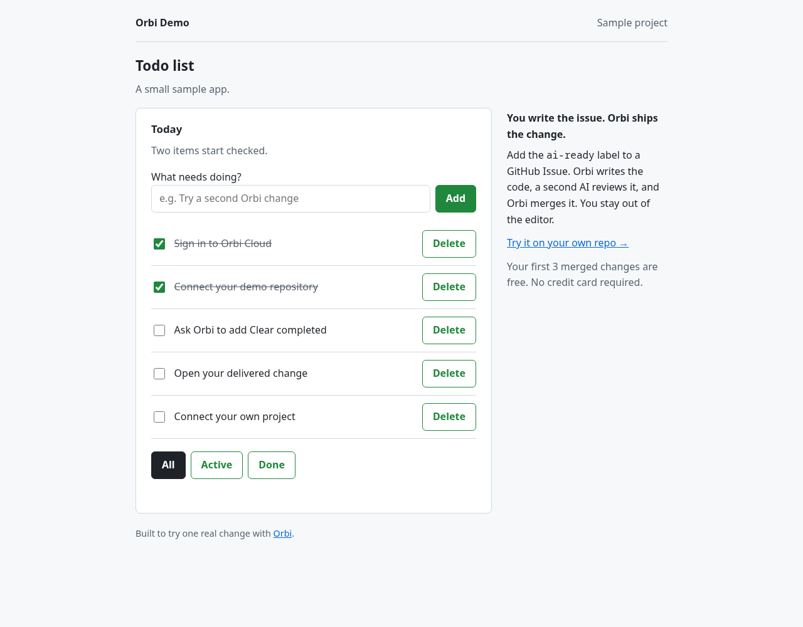

# orbi-demo

Try an example onboarding checklist, then ask [Orbi](https://orbi.build/?ref=gh-orbi-demo) to add a useful feature in your own copy. Start with **Clear completed**: after Orbi merges it, you open your copy's web page and use the new button.

[Open the live example](https://orbi-build.github.io/orbi-demo/) — no installation or sign-in needed. The checked items are sample progress, not your account status. Your edits on this page reset when you refresh. Changes Orbi makes in your copy show up on your copy's own page, not on this one.



<details>
<summary>Watch the 44-second beta demo</summary>

Clear completed before and after a real Orbi delivery. The waiting time is cut out. Recorded on beta; follow the steps and current trial terms below.

https://github.com/user-attachments/assets/aecc3297-bcd2-4fbc-85a3-dfed736dacff

</details>

## 1. Create your copy

Click [Use this template](https://github.com/orbi-build/orbi-demo/generate) and create a repository in your GitHub account. Choose **Public**: GitHub Pages is free for public repositories. Keep the name `orbi-demo` so the addresses below only need your username.

A template creates an independent repository with its own issues and history. Orbi uses GitHub's template source to recognize the official sample; use the template button when creating it.

## 2. Turn on GitHub Pages

In your copy, open **Settings → Pages**. Under **Build and deployment**, choose **Deploy from a branch**, pick `main` and `/ (root)`, then **Save**.

After a few minutes your copy is live at `https://YOUR-USERNAME.github.io/orbi-demo/`. Open it: this is the page Orbi's change will show up on.

### Or run it locally

You need **Node.js 20 or later** and Git. You can run the app locally without installing packages, adding API keys, or signing in to Orbi.

Replace `YOUR-USERNAME` with your GitHub username. If you chose another repository name, use that name in both commands too.

```sh
git clone https://github.com/YOUR-USERNAME/orbi-demo.git
cd orbi-demo
npm start
```

Open **http://127.0.0.1:4178/**. Keep the terminal running; press `Ctrl+C` to stop the server. If port 4178 is in use, stop the process using that port and run `npm start` again.

The sample checklist shows how to get started with Orbi: sign in, connect the demo repository, request a change, open the delivered app, and move to your own project. Two items start checked as examples. You update the list yourself; it does not track your Orbi account.

Try adding a task, checking it off, deleting it, and switching between All, Active and Done. The list resets to the example tasks when you refresh. Keeping your changes after a refresh is one of the features you can ask Orbi to add.

Use `npm start` to serve the page over HTTP. Opening `index.html` directly prevents the browser from loading its JavaScript modules.

## 3. Let Orbi add Clear completed

1. Open the [Orbi Cloud dashboard](https://orbi.build/api/?ref=gh-orbi-demo) and sign in with GitHub. Before connecting, check your available project slots and the [current trial terms](https://orbi.build/cloud/?ref=gh-orbi-demo). The sample uses one project slot.
2. Install the Orbi GitHub App for your copy and select it on **Connect repository**. If the new copy is missing, add it to the App's repository access and refresh the page.
3. Wait until the dashboard shows that your project’s work environment is ready. Choose **Clear completed** from the sample tasks if the dashboard offers it. Otherwise, open an issue in **your copy** with the request below and add the `ai-ready` label. If it is missing, create it under your repository’s **Issues → Labels** first.

   > **Add a Clear completed button**
   >
   > Add a button that removes completed tasks and keeps active tasks. Keep the existing filters working. The new button should be reachable with Tab and usable with Enter. Add tests for the list logic.

Orbi posts progress on the issue, writes the change, and opens a pull request. A second AI reviewer checks the change. Orbi merges it once checks pass, unless your repository requires human approval. If it needs help, the dashboard and issue explain what is blocking it.

You can also ask for a remaining-task count or for the list to survive a page refresh. These features are deliberately left out of the starting app so you have a change to try.

## 4. Open your delivered change

Wait until your task shows a **merged pull request**. Closing an issue alone does not mean the code was merged.

Open `https://YOUR-USERNAME.github.io/orbi-demo/` again. GitHub Pages republishes `main` after the merge; it can take up to 10 minutes. Refresh until the new button appears.

To check Clear completed, mark a task done and click the new button. Completed tasks should disappear; active tasks should stay.

### If you run it locally

In your local copy, check for uncommitted changes and confirm your current branch:

```sh
git status --short
git branch --show-current
```

Continue once the working tree is clean and you are on the branch Orbi merges into (`main` unless you chose another base branch). Commit or stash local edits before switching branches. Then update:

```sh
git pull --ff-only
```

If `npm start` is still running, refresh the browser. If you stopped it, run `npm start` again and open http://127.0.0.1:4178/.

## Run the tests

```sh
npm test
```

Tests check the list logic and make real HTTP requests to the local server. CI runs them on pull requests with Node.js 20 and 22.

- `src/todo.js`: pure functions for adding, completing, removing and filtering tasks.
- `src/app.js` and `src/style.css`: the browser interface.
- `scripts/start.js` and `scripts/server.js`: the local HTTP server, bound to this computer only.

## Move to your own project

After you have tried a change, use **Manage projects** in Cloud to connect your real repository. If your project slots are full, disconnect the idle sample there first. Disconnecting reclaims Orbi’s work environment without changing the GitHub repository; delivery history and usage records remain available.

For help, email [support@orbi.build](mailto:support@orbi.build) with your repository and issue or pull request URL. You can inspect other real deliveries too: [a merge-method fix](https://orbi.build/proof/orbi-build/orbi/1480?ref=gh-orbi-demo) and [a branch-cleanup fix](https://orbi.build/proof/orbi-build/orbi/1478?ref=gh-orbi-demo).

## License

MIT
